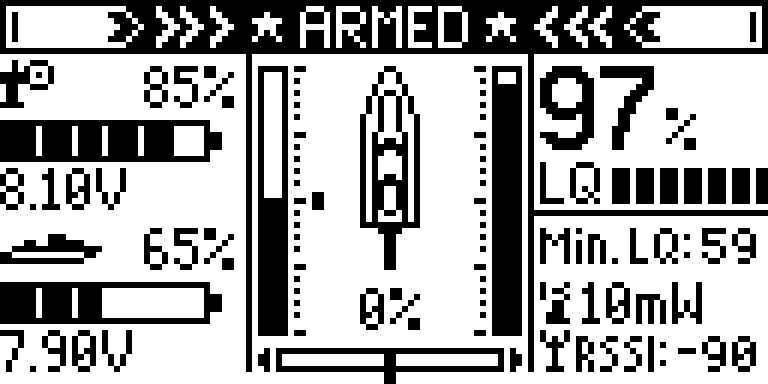

# MT12 Lua scripts

Version 1.01.

Telemetry screens for the Radiomaster MT12 running EdgeTX. The screen is 128×64 pixels, black and white.

The first script is **boat** 1.01, a race-boat dashboard. It shows throttle, steering, trims, the throttle limit, both batteries, and the ExpressLRS link on one page.



The picture above is the screen at idle: armed, throttle and steering centered, transmitter at 8.10 V, boat battery at 7.90 V, link quality 97%.

The script only displays values. It does not limit the throttle or force the outputs to zero. Arming safety and the throttle cap belong in the model, as mixes, curves, logical switches, and special functions. The screen then reads the result.

## Status

This screen was written with AI.

There are no plans to maintain it or add anything further. Issues will be ignored.

The code is under the [MIT license](LICENSE). You can reuse it, change it, and ship it in your own work.

## The screen

**Banner.** With a link, the banner shows `ARMED` while the arm source is on. Otherwise it alternates `SAFE` and the model name. With no link it alternates `NO LINK` and the time since the link dropped, for example `1:27`. The texts, the switch, and the timing are all settings.

**Left column.** Transmitter battery on top, boat battery below. Each row is an icon, a percent, a six-cell bar, and the voltage. A battery blinks while its percent is under its warning level. The transmitter scale is a straight line between two voltages. The boat battery uses a LiPo discharge curve, stretched to the cell count and the empty and full cell voltages.

**Center.** The boat is a top view, bow up. The wake grows with forward throttle and stays hidden at idle and in reverse. The rudder under the motor follows the steering channel.

- The left bar is the throttle the radio is actually sending. With the default range, the bar is empty at −100%, half full at 0%, and full at +100%. The mark to the right of the bar is the throttle trim. It is a 2×3 block when the trim is centered, and an arrow when it is not.
- The right bar is the throttle limit from a pot. It fills from the bottom. There is no trim mark on this bar.
- The percent under the boat is the throttle being sent.
- The bar along the bottom is the steering channel. The mark under that bar is the steering trim, drawn the same way as the throttle trim.

**Right column.** Link quality as a large percent, a seven-block meter, the lowest link quality since the link came up, transmitter power in mW, and RSSI. Link quality and the minimum blink under their warning levels.

## Install

1. Copy `SCRIPTS/TELEMETRY/boat.lua` to `SCRIPTS/TELEMETRY/` on the radio's SD card.
2. On the radio, open the model and go to **Display**. Set a screen to **Script** and choose `boat`.
3. From the Home Screen, press the Telemetry button to open these pages.

EdgeTX telemetry script names can be at most six characters. `boat` fits. After copying, eject the card before unplugging the radio. If an old `boat.luac` is sitting next to the new file, delete it so the radio compiles the new script.

## What the model has to provide

The defaults match a surface model with this layout. Change the settings at the top of `boat.lua` if yours differs.

| What the screen shows | Default source | Where it comes from |
| --- | --- | --- |
| Throttle | Channel 2 (output index 1) | The channel output, after mixes and overrides |
| Steering | Channel 3 (output index 2) | The channel output, after mixes and overrides |
| Armed | Logical switch L02 | Whatever the model uses to unlock the outputs |
| Throttle limit | Pot S1 | A curve, so the bar matches the mix |
| Transmitter battery | `tx-voltage` | The radio |
| Boat battery | `RxBt` | Receiver telemetry |
| Link quality | `RQly` and `RQly-` | ExpressLRS |
| Power and RSSI | `TPWR` and `1RSS` | ExpressLRS |
| Trims | `trim-th` and `trim-st` | The throttle and steering trims |

A working arm setup looks like this. L01 latches once the arm switch has been seen in the safe position. L02 is on only when that latch is set and the switch is in the arm position. Special functions force the throttle and steering channels to 0 while L02 is off. The banner then follows L02, so it cannot say `ARMED` while the outputs are still held at 0.

The right bar is a display of the pot. The default mapping is 10% with the pot fully down, 50% centered, and 100% fully up. The curve in the model that scales the throttle should use the same three points, or the bar and the channel will disagree. `LIMIT_LOW`, `LIMIT_MID`, and `LIMIT_HIGH` are those three points.

On the Telemetry page, run **Discover new sensors** once with the receiver on. Until `RxBt`, `RQly`, `TPWR`, or `1RSS` arrives, the link fields show dashes and the banner says `NO LINK`.

## Settings

Everything you should change is at the top of `boat.lua`, between `SETTINGS` and `END OF SETTINGS`. Each line has a short comment.

A source can be one name in quotes, or a list. A list uses the first name that exists on that radio:

```lua
local RX_SRC = { "RxBt", "RXbt", "RXBt" }
local TX_SRC = "tx-voltage"
```

Channel numbers start at 0, so 0 is CH1, 1 is CH2, and 2 is CH3. `THR_SIGN` and `RUD_SIGN` are `1` or `-1`. Set one to `-1` when forward shows as reverse, or steering is mirrored. The trim signs are separate, so a backwards trim arrow can be flipped without flipping the channel.

### Channels, bars, and the rudder

| Setting | Default | Meaning |
| --- | --- | --- |
| `THR_OUT` | `1` | Throttle channel output. 1 is CH2. |
| `RUD_OUT` | `2` | Steering channel output. 2 is CH3. |
| `THR_SIGN`, `RUD_SIGN` | `1` | Flip the reading when the channel runs backwards. |
| `THR_BAR_MIN`, `THR_BAR_MAX` | `-100`, `100` | Throttle percent at the bottom and top of the left bar. Use `0` and `100` for a forward-only speed controller. |
| `WAKE_MIN` | `0` | Throttle percent above which the wake is drawn. |
| `RUD_BAR_MAX` | `100` | Steering percent that reaches the end of the bottom bar. |
| `RUDDER_SWING` | `1.25` | How far the rudder on the boat moves. `0` keeps it straight. |

### Trims

| Setting | Default | Meaning |
| --- | --- | --- |
| `THR_TRIM_SRC` | `trim-th`, then other likely names | Throttle trim. The arrow beside the left bar. |
| `RUD_TRIM_SRC` | `trim-st`, then other likely names | Steering trim. The arrow under the bottom bar. |
| `THR_TRIM_SIGN`, `RUD_TRIM_SIGN` | `1` | Flip a trim arrow that moves the wrong way. |

If a trim arrow never moves, none of the names in the list exist on that radio. Look the trim up in the radio's source list and put that name first.

### Arming and the banner

| Setting | Default | Meaning |
| --- | --- | --- |
| `ARM_LS` | `2` | Logical switch number. 2 is L02. Set to `0` to read a physical switch instead. |
| `ARM_SRC` | `sa` | Switch used when `ARM_LS` is 0. |
| `ARMED_POS` | `"down"` | Position of `ARM_SRC` that means armed: `"up"`, `"mid"`, or `"down"`. |
| `ARMED_TEXT` | `"ARMED"` | Banner while armed. |
| `SAFE_TEXT` | `"SAFE"` | Banner while not armed. |
| `SHOW_NAME` | `true` | While not armed, alternate `SAFE_TEXT` with the model name. |
| `BANNER_TIME` | `1.5` | Seconds each for the two alternating texts. |
| `NO_LINK_TEXT` | `"NO LINK"` | Banner while telemetry is missing. |

Banner text can use A–Z, digits, space, `-`, and `_`. The large font fits about seven characters between the stars. A longer word drops the stars, then switches to a smaller font and is cut to fit.

### Throttle limit

| Setting | Default | Meaning |
| --- | --- | --- |
| `LIMIT_SRC` | `s1`, then `S1`, `p1`, `P1` | Pot that sets the limit. |
| `LIMIT_LOW` | `10` | Limit percent with the pot fully down. |
| `LIMIT_MID` | `50` | Limit percent with the pot centered. |
| `LIMIT_HIGH` | `100` | Limit percent with the pot fully up. |
| `LIMIT_BAR_MIN`, `LIMIT_BAR_MAX` | `0`, `100` | Limit percent drawn as an empty bar and as a full bar. |

### Batteries

| Setting | Default | Meaning |
| --- | --- | --- |
| `TX_SRC` | `tx-voltage` | Transmitter voltage source. |
| `TX_MIN`, `TX_MAX` | `6.4`, `8.4` | Volts at 0% and 100% for the radio pack. |
| `TX_WARN` | `20` | Transmitter percent where blinking starts. |
| `RX_SRC` | `RxBt` | Boat battery voltage from the receiver. |
| `RX_CELLS` | `2` | Cells in series. |
| `CELL_MIN`, `CELL_MAX` | `3.40`, `4.20` | Volts per cell at 0% and 100%. |
| `RX_CURVE` | `true` | `true` uses a LiPo discharge curve. `false` draws a straight line between empty and full. |
| `RX_PER_CELL` | `true` | A reading between 2.5 V and 4.45 V is one cell, and is multiplied by `RX_CELLS`. |
| `RX_WARN` | `10` | Boat battery percent where blinking starts. |

The LiPo curve is stored per cell and stretched to `CELL_MIN` and `CELL_MAX` when the script loads. A 3S pack, or a different empty voltage, only needs `RX_CELLS` or `CELL_MIN` changed.

### Link

| Setting | Default | Meaning |
| --- | --- | --- |
| `LQ_SRC` | `RQly` | Link quality, 0 to 100. |
| `LQ_MIN_SRC` | `RQly-` | Lowest link quality. |
| `TPWR_SRC` | `TPWR` | Transmitter power in mW. |
| `RSSI_SRC` | `1RSS` | RSSI in dBm. |
| `LQ_WARN` | `50` | Big link-quality number blinks below this. |
| `LQ_MIN_WARN` | `50` | Minimum link quality blinks below this. |
| `BLINK_TIME` | `1.0` | Length of one blink, in seconds. |
| `BLINK_ON` | `0.6` | Fraction of the blink the warning stays visible. |

Keep every minimum different from its matching maximum. `THR_BAR_MIN` equal to `THR_BAR_MAX`, or the same pair on the limit bar, makes that bar's scale divide by zero.

## No link

The script remembers the last boat voltage, link quality, minimum link quality, power, and RSSI. When telemetry stops, those values stay on screen and blink, so a frozen reading is easy to tell from a live one. The icons and labels stay put. The banner alternates `NO LINK` with the time since the drop.

The loss is also timed from `background()`, which EdgeTX keeps calling while another screen is showing. Coming back to the script still shows how long the link has been gone.

If the receiver has not connected since the script started, there is nothing to remember. The banner shows `NO LINK` and the link fields stay as dashes.

As soon as any of RSSI, link quality, or the boat voltage is received again, the banner returns to `ARMED` or `SAFE` and the values stop blinking.
